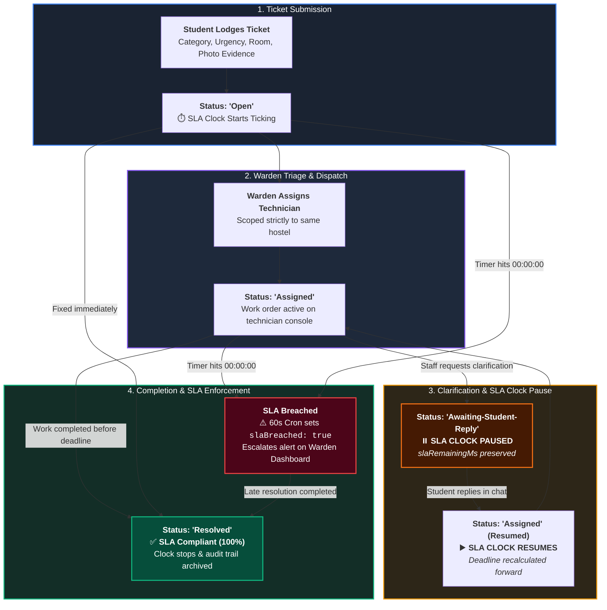
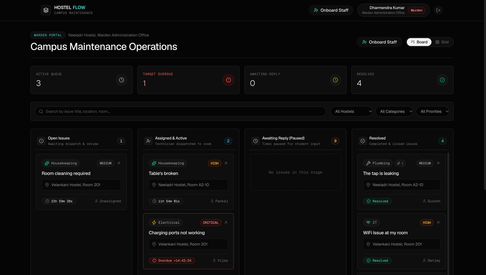
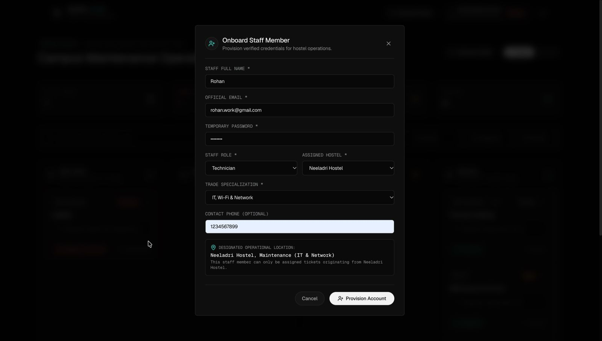
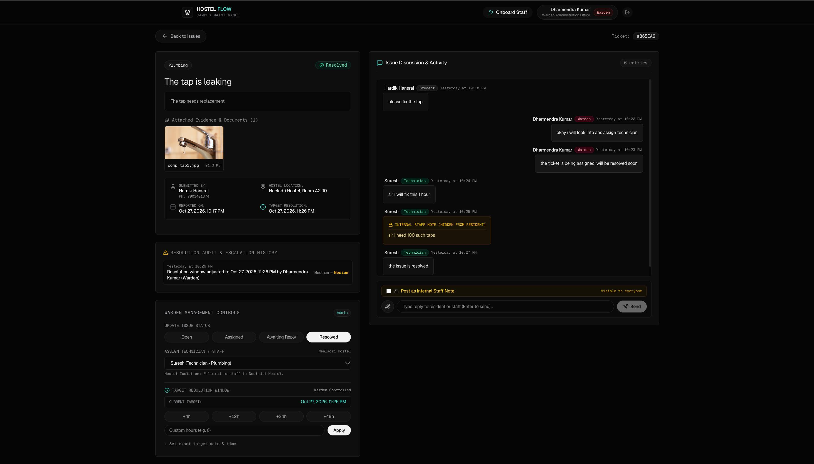
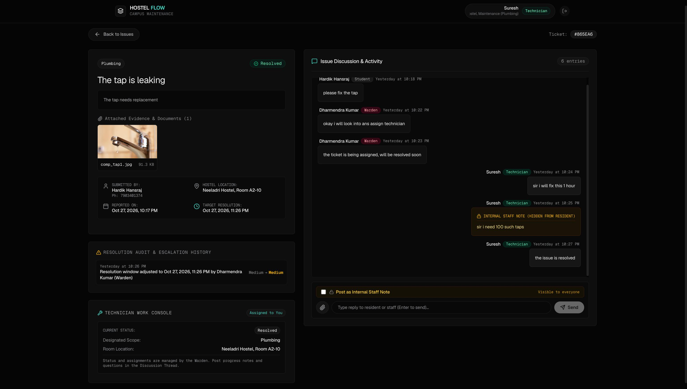
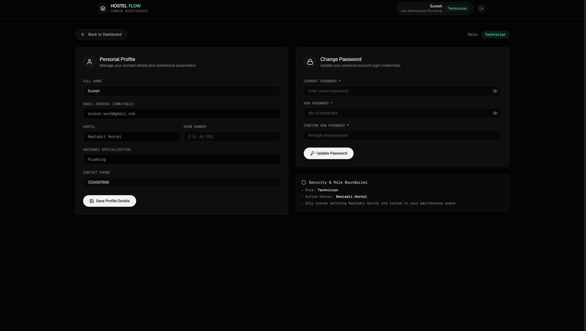
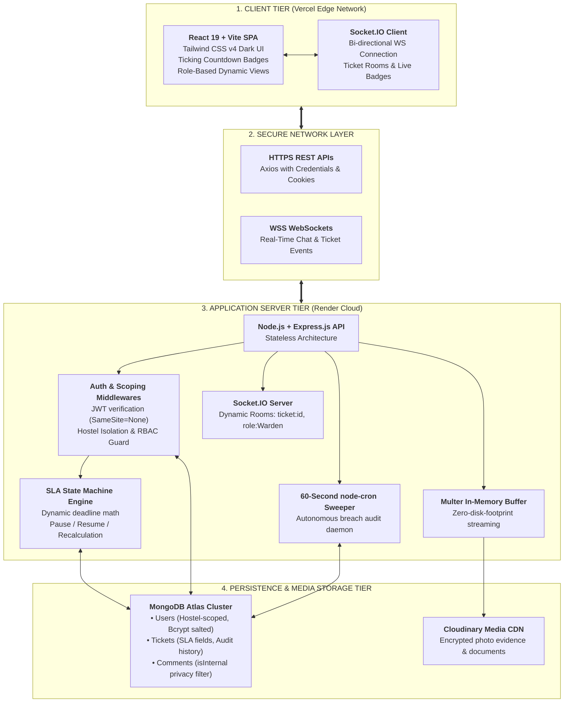

# HostelFlow - SLA-Driven Issue Resolution & Governance Engine

> **An enterprise-grade, real-time Service Level Agreement (SLA) governance and maintenance tracking platform built for Scaler School of Technology (SST) student residential hostels.**

[](https://hostel-flow-eta.vercel.app)
[](https://hostelflow-xdvr.onrender.com/health)
[](https://drive.google.com/file/d/1DRDWiLU063El_4_2156twJnigEhRTtUK/view?usp=sharing)
[](https://github.com/HardikH25/HostelFlow)
[](https://www.mongodb.com/atlas)

---

## Deployment

HostelFlow is continuously deployed using modern cloud-native edge infrastructure:

| Resource | Platform | Environment | URL / Endpoint |
| :--- | :--- | :--- | :--- |
| 🚀 **Live Web Application** | **Vercel** | Production Edge | [https://hostel-flow-eta.vercel.app](https://hostel-flow-eta.vercel.app) |
| ⚡ **Backend REST & WebSocket API** | **Render** | Production Web Service | [https://hostelflow-xdvr.onrender.com](https://hostelflow-xdvr.onrender.com) |
| 🩺 **Backend Health & Uptime Probe** | **Render** | System Endpoint | [https://hostelflow-xdvr.onrender.com/health](https://hostelflow-xdvr.onrender.com/health) |
| 🎥 **Walkthrough Demonstration Video** | **Google Drive** | Video Showcase | [Watch Demo Video](https://drive.google.com/file/d/1DRDWiLU063El_4_2156twJnigEhRTtUK/view?usp=sharing) |
| 📁 **Source Code Repository** | **GitHub** | Main Branch | [https://github.com/HardikH25/HostelFlow](https://github.com/HardikH25/HostelFlow) |

---

## Problem Statement

In large-scale collegiate residential ecosystems—such as Scaler School of Technology's **Neeladri** and **Velankani** hostels housing hundreds of students—facilities management has historically suffered from broken communication channels, delayed resolutions, and a total absence of accountability.

Traditional campus maintenance breaks down across four critical operational bottlenecks:

1. **Unenforced Deadlines & Zero SLA Accountability**: Maintenance requests logged through WhatsApp messages, physical logbooks, or Google Sheets lack legally or operationally binding resolution timelines. Tickets linger for weeks without escalation triggers or institutional visibility.
2. **The "Communication Black Hole"**: Once a resident lodges an issue, they are left blind to its progress. They cannot verify whether the warden has acknowledged the request, whether spare parts were requisitioned, or when a technician will arrive, prompting constant repetitive inquiries at the warden office.
3. **Cross-Hostel Resource Fragmentation**: Maintenance technicians are frequently misdispatched across different buildings without geographical isolation. A plumbing technician assigned to Neeladri Hostel is erroneously tasked with a room in Velankani Hostel, causing travel delays, lost work hours, and neglected repairs.
4. **Lack of Confidential Diagnostic Channels**: Technicians and wardens frequently need to discuss internal diagnostics, vendor procurement, or resident damage culpability without exposing unvetted remarks to the student. Without an internal notes mechanism, communication either spills into private chat channels or causes student friction.

---

## Target Users

HostelFlow provides purpose-built interfaces and scoped permissions tailored for three distinct campus stakeholder personas:

| User Persona | Scope & Environment | Core Capabilities & Permissions |
| :--- | :--- | :--- |
| **Students (Residents)** | Personal Room & Hostel Scope *(Neeladri / Velankani)* | • Lodge categorized maintenance tickets with photo/document evidence.<br>• Track live, ticking SLA countdown timers down to the second.<br>• Engage in transparent real-time 3-way discussion with staff.<br>• Receive instant updates when a technician is dispatched or arrives. |
| **Hostel Wardens (Admins)** | Building & Campus Command Center | • Kanban triage board with live breach counters and status columns.<br>• Dispatch trade-specialized technicians strictly within the matching hostel.<br>• Adjust or extend target resolution windows with immutable audit logging.<br>• Onboard new technicians and fellow wardens with trade/hostel scoping.<br>• Review campus compliance metrics, breach rates, and operational bottlenecks. |
| **Technicians (Ground Staff)** | Building Work Order Queue *(Plumbing, Electrical, Carpentry, IT, Appliances)* | • Dedicated work console showing assigned tasks, room numbers, and student phone contacts.<br>• Post confidential **Internal Staff Notes** hidden from residents.<br>• Request resident input (automatically freezing the SLA clock).<br>• Advance ticket lifecycle through resolution with completion notes. |

---

## Solution

**HostelFlow** replaces ad-hoc complaints with an **SLA-governed state machine** backed by full-duplex WebSockets, automated background cron auditing, and multi-tenant hostel isolation.

Every raised issue is bound to a Category *(Plumbing, Electrical, Carpentry, Appliance, Network)* and an Urgency Level *(Low, Medium, High, Critical)*, automatically calculating an immutable target resolution deadline.



### The 3-Tier SLA Clock Engine

1. **Ticking State (`Open` / `Assigned`)**: The client calculates remaining milliseconds between current time and `targetResolutionDate`. High-contrast badges visually reflect urgency (emerald for ample time, amber for approaching deadlines, red for imminent breaches).
2. **Paused State (`Awaiting-Student-Reply`)**: When technicians require room access confirmation or details, transitioning to this state stores `slaPausedAt` and freezes `slaRemainingMs`. This ensures maintenance personnel are not unfairly penalized for student unresponsiveness.
3. **Resumption & Extension**: When the student replies in the ticket thread, the system automatically reactivates the timer, recalculating `targetResolutionDate = Date.now() + slaRemainingMs`. Wardens can also inject extension buffers (`+4h`, `+12h`, `+24h`, `+48h`), appending an immutable entry to the audit log.

---

## Key Features

### 1. Warden Operations Kanban Board & SLA Command Center
A comprehensive operational cockpit providing institutional oversight across all campus buildings. Wardens monitor real-time compliance metrics, active work orders, and breached tickets. The multi-column Kanban board organizes tickets into **Open**, **Assigned & Active**, **Awaiting Reply (Paused)**, and **Resolved**, complete with category filter pills and live countdown badges.



*Figure 1: Warden Command Center showing campus compliance percentage, active work orders, 4-stage Kanban columns, and trade filtering.*

---

### 2. Administrative Staff Onboarding with Trade Specialization
Wardens can provision new staff directly from the portal without developer intervention. Each technician is provisioned with a specific **Hostel Location** *(Neeladri Hostel or Velankani Hostel)* and a **Trade Specialization** *(Plumbing, Electrical, Carpentry, Appliance, IT / Network)*, guaranteeing strict multi-tenant boundary enforcement.



*Figure 2: Staff onboarding modal configuring name, email, technician role, hostel assignment, and trade specialization.*

---

### 3. 3-Way Ticket Discussion & Confidential Internal Staff Notes
Every ticket features a full-duplex comment thread connecting the Student, Warden, and Assigned Technician. Staff members can toggle **"Post as Internal Staff Note"** (marked in high-contrast amber). The backend API strips internal notes from student responses at the controller layer, allowing staff to discuss diagnostics and parts ordering privately.



*Figure 3: Detailed ticket view displaying photo evidence, Warden SLA extension buttons (+4h, +12h, etc.), technician assignment dropdown with hostel isolation, and 3-way chat with private internal staff notes.*

---

### 4. Technician Work Console & Mobile-Ready Execution
Technicians receive a dedicated, distraction-free work queue displaying tickets assigned to their trade and hostel. The console presents student phone numbers for rapid dispatch, exact room numbers, uploaded photo evidence, and one-tap status toggling.



*Figure 4: Technician Console displaying assigned ticket #865EA6 (Plumbing), room location A2-10, resident contact number, and internal diagnostic communications.*

---

### 5. Multi-Tenant Hostel Boundary Enforcement & Profile Scoping
Technicians and wardens operate within explicit geographic boundaries. A technician registered to Neeladri Hostel is physically incapable of being assigned to Velankani Hostel issues—the assignment dropdown dynamically filters candidates, and backend route handlers reject cross-hostel payloads.



*Figure 5: Technician profile view confirming active hostel assignment (Neeladri Hostel), assigned trade, and security boundary isolation.*

---

### 6. Cloud-Native Media Evidence Pipeline
Students and technicians upload image or document evidence (JPEG, PNG, WEBP, PDF) directly via Multer memory buffers to **Cloudinary CDN**. Evidence is displayed inline with full thumbnail previews, file size indicators, and one-click full-resolution viewing.

---

### 7. Autonomous 60-Second Background SLA Sweeper (`slaCron.js`)
An autonomous in-process background daemon executes every 60 seconds using `node-cron`. It queries all non-resolved tickets where `targetResolutionDate < Date.now()` and sets `slaBreached = true`, broadcasting instant escalation alerts via Socket.IO without requiring client page refreshes.

---

## Tech Stack

| Tier / Layer | Technology | Version | Architectural Rationale |
| :--- | :--- | :--- | :--- |
| **Frontend Framework** | **React** | `19.0.0` | Ultra-fast rendering engine utilizing modern hooks, Suspense, and state preservation. |
| **Build Tooling** | **Vite** | `6.2.0` | Sub-millisecond Hot Module Replacement (HMR) and optimized Rollup production bundling. |
| **Styling & Design System** | **Tailwind CSS** | `4.0.0` | Consistent design tokens, custom glassmorphism overlays, and dark theme palette. |
| **Backend Runtime** | **Node.js** | `v18+` (ESM) | Asynchronous, event-driven runtime handling concurrent REST requests and persistent WebSocket connections. |
| **API Framework** | **Express.js** | `4.21.0` | Modular HTTP middleware pipeline for routing, JWT validation, and RBAC enforcement. |
| **Database** | **MongoDB Atlas** | Replica Set | Cloud-hosted NoSQL document database providing dynamic schemas for ticket audit trails. |
| **ODM Layer** | **Mongoose** | `8.12.0` | Schema validation, lifecycle pre/post hooks, and indexed geospatial and role querying. |
| **Real-Time Duplex** | **Socket.IO** | `4.8.1` | Low-latency bi-directional messaging with fallback polling and targeted room namespaces. |
| **Autonomous Scheduling**| **Node-cron** | `3.0.3` | Reliable in-memory cron runner executing the 60-second SLA breach sweep daemon. |
| **Media CDN Storage** | **Cloudinary** | `1.41.3` | Zero-disk-footprint streaming of evidence photos and documents via Multer memory buffers. |
| **Security & Auth** | **JWT + Bcrypt.js + Helmet** | Latest | Stateless bearer token auth with cross-domain SameSite=None secure cookies and HTTP security headers. |

---

## Architecture

HostelFlow is built on an enterprise four-tier architecture designed for horizontal scalability, zero-disk file persistence, and real-time state synchronization.



### Architectural Highlights

1. **Stateless Authentication with Secure Cross-Origin Cookies**: The backend issues signed JSON Web Tokens (JWT) stored in `httpOnly`, `SameSite=None`, `Secure` cookies. This protects against XSS attacks while permitting seamless cross-origin requests between the Vercel frontend (`vercel.app`) and Render backend (`onrender.com`).
2. **Dynamic Socket Rooms**: When a user opens Ticket `#865EA6`, their client joins the socket room `ticket:865EA6`. Comments, status shifts, and SLA recalculations are broadcast exclusively to active participants in that room, minimizing socket chatter.
3. **Multi-Tenant Database Design**: All ticket queries in the warden dashboard and technician console are automatically scoped by `hostelLocation`. Technicians can never query or receive assignments outside their registered facility.

---

## Local Setup

Follow these steps to run HostelFlow locally on your development machine.

### Prerequisites
- **Node.js**: `v18.0.0` or higher
- **npm**: `v9.0.0` or higher
- Active **MongoDB Atlas** cluster or local MongoDB instance
- **Cloudinary** developer account (for media evidence uploads)

### 1. Clone the Repository
```bash
git clone https://github.com/HardikH25/HostelFlow.git
cd HostelFlow
```

### 2. Configure & Run Backend Server
```bash
cd server

# Install dependencies
npm install

# Create environment configuration
cp .env.example .env
# Edit server/.env with your MongoDB URI, JWT Secret, and Cloudinary credentials

# Launch backend in development mode
npm run dev
# Backend active on http://localhost:5005
```

### 3. Configure & Run Frontend Client
```bash
# Open a new terminal window
cd ../client

# Install dependencies
npm install

# Launch frontend Vite dev server
npm run dev
# Frontend active on http://localhost:5173
```

---

### Seed Accounts for Evaluation & Testing

The platform includes pre-configured seed accounts across all roles and hostels for instant testing:

| Persona | Email Address | Password | Assigned Hostel Scope | Operational Context |
| :--- | :--- | :--- | :--- | :--- |
| **Warden (Admin)** | `surender@scaler.com` | `12345678` | Neeladri Hostel | Full triage board, technician dispatch, SLA overrides |
| **Warden (Admin)** | `sunil@scaler.com` | `12345678` | Velankani Hostel | Velankani administration & staff onboarding |
| **Student (Resident)** | `hardik@gmail.com` | `12345678` | Neeladri Hostel (Room A2-10) | Lodge complaints, view ticking SLA clock, chat with staff |
| **Technician (Staff)** | `ramesh.work@gmail.com` | `12345678` | Neeladri Hostel (Plumbing) | View assigned work orders, post internal notes, mark resolved |

---

## Environment Variables

### Backend (`server/.env`)
Documented configuration schema (sensitive credentials masked):

```env
# Application Port & Cross-Origin Configuration
PORT=5005
CLIENT_URL=https://hostel-flow-eta.vercel.app
NODE_ENV=production

# Persistence Layer
dbURL=mongodb+srv://<username>:<password>@cluster0.mongodb.net/hostel_sla_db?retryWrites=true&w=majority

# Authentication & Session Security
JWT_SECRET=your_jwt_secret_key_scaler_2026
COOKIE_SECURE=true

# Cloudinary Media Storage Pipeline
CLOUDINARY_CLOUD_NAME=your_cloudinary_cloud_name
CLOUDINARY_API_KEY=your_cloudinary_api_key
CLOUDINARY_API_SECRET=your_cloudinary_api_secret
```

### Frontend (`client/.env`)
```env
# URL of the Backend API (Render in production, localhost in development)
VITE_API_URL=https://hostelflow-xdvr.onrender.com
```

---

## License

This project is developed and submitted as the End-Term Software Engineering Project for **Scaler School of Technology (SST)**. Licensed under the [MIT License](LICENSE).
